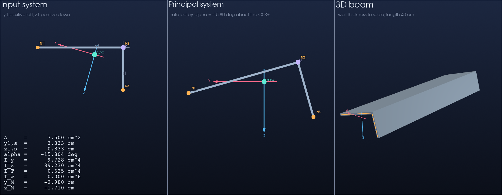
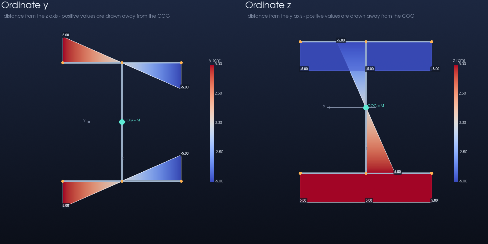
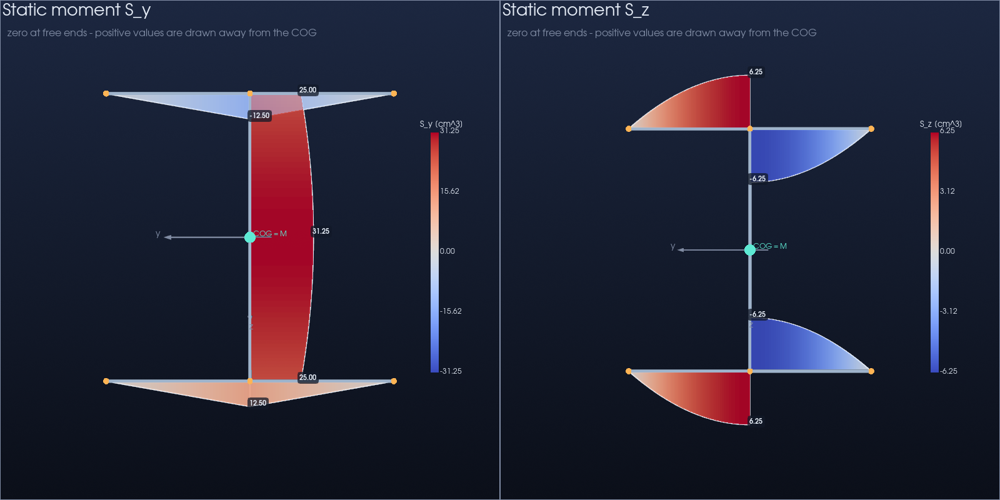
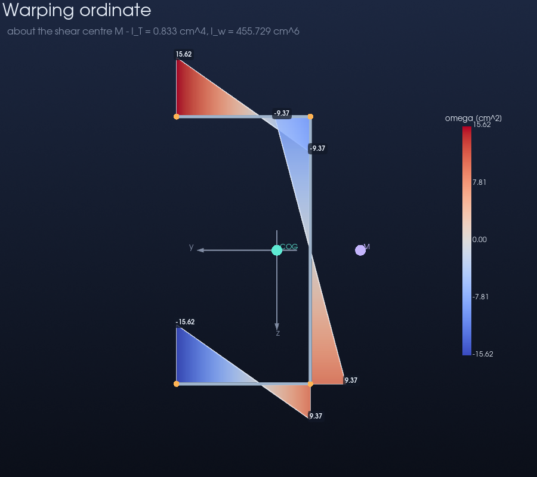
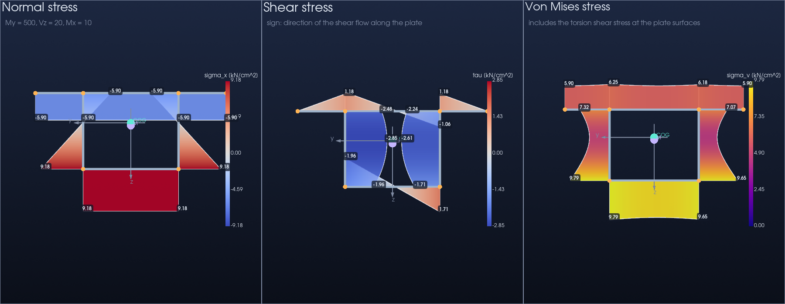

# Cross-Section Analysis Tool

[](https://github.com/shoaib-joo/Cross-section-analysis/actions/workflows/tests.yml)

A Python tool for analysing thin-walled structural cross-sections with a centerline model. It computes bending and torsion properties of open and closed sections, the stresses for a set of internal forces, and shows everything in interactive 3D views.

The notation follows Kindmann & Kraus, *Steel Structures: Design using FEM*.



## Features

- **Flexible geometry** – describe a section with nodes and connecting plates. Every plate can have its own thickness. Open sections, closed boxes, multi-cell boxes and mixtures of both are supported.
- **Bending properties** – area, centre of gravity, principal axis angle α, moments of inertia I_y and I_z, radii of gyration, elastic and plastic section moduli
- **Torsion properties** – shear centre M, torsion constant I_T, warping ordinate ω and warping constant I_ω
- **Static moments** S_y(s) and S_z(s) along every plate, including the shear flow in closed cells
- **Stresses** – normal stress, shear stress and von Mises stress for N, M_y, M_z, V_y, V_z, M_x and a warping bimoment
- **Visualisation** with PyVista: input and principal systems, an extruded 3D beam, and coloured diagrams drawn on the section
- **Section library** – 16 ready-made sections, including an IPE 200 and three closed boxes

## Installation

Requires Python 3.10 or newer.

```bash
git clone https://github.com/shoaib-joo/Cross-section-analysis.git
cd Cross-section-analysis
pip install -r requirements.txt
```

The calculations in `model.py` use only the Python standard library. NumPy and PyVista are needed for the plots.

## Quick start

```bash
python main.py              # choose a section from a menu
python main.py --list       # show the available sections
```

```
Available cross-sections:

   1  I-Section       I-beam, flanges 10 cm, height 10 cm
   2  IPE-200         Rolled IPE 200 without fillets: flanges 0.85 cm, web 0.56 cm
   3  Cruciform       Cross of two 10 cm plates
   4  Channel         U-profile, flanges 5 cm, web 10 cm
   5  Lipped-Channel  C-profile with 1.5 cm lips
   6  T-Section       T-profile, flange 10 cm, web 10 cm
   7  Mono-I          I-beam with unequal flanges (10 cm and 6 cm)
   8  Hat             Top-hat profile with 3 cm brims
   9  Equal-Angle     L-profile, legs 10 x 10 cm (principal axes at 45 deg)
  10  Custom          Box 19 x 18.65 cm with a slit in one flange (open)
  11  Angle           L-profile, legs 10 x 5 cm (rotated principal axes)
  12  Z-Section       Z-profile, flanges 5 cm, web 10 cm (rotated principal axes)
  13  Lipped-Z        Z-profile with 1.5 cm lips (rotated principal axes)
  14  Box             Closed rectangular hollow section 10 x 20 cm
  15  Two-Cell-Box    Closed box 20 x 10 cm with a middle web (two cells)
  16  Box-Girder      Closed box 10 x 8 cm with cantilevering top flange
```

Pick a section by name or by its number. Names ignore case, spaces and hyphens.

```bash
python main.py --section Angle                    # by name
python main.py --section 8                        # by number (Hat)
python main.py -s "lipped z" -t 0.5               # one thickness for all plates [cm]
python main.py -s I-Section -t 0.8 0.8 0.5 0.8 0.8    # one thickness per plate
python main.py -s IPE-200 --Vz 50 --My 2000       # stresses for a load case
python main.py -s Box --Mx 100 --no-plot          # numbers only, no plot windows
```

| Option | Meaning |
|---|---|
| `-s`, `--section NAME` | Section to analyse: a name or a number from `--list`. Without it, a menu is shown. |
| `-l`, `--list` | Show the available sections and exit |
| `-t`, `--thickness T [T ...]` | Wall thickness in cm: one value for all plates, or one per plate in the order of the element list. Default 0.124, or the section's own thicknesses (IPE-200). |
| `--no-plot` | Print the results without opening the plot windows |
| `--N`, `--My`, `--Mz`, `--Vy`, `--Vz`, `--Mx`, `--Mw` | Internal forces. Give at least one to get stresses. |

Units are cm, kN and kNcm, which gives stresses in kN/cm². Loads refer to the principal axes, and shear forces act through the shear centre.

Example output for `python main.py -s IPE-200 --Vz 50 --My 2000 --no-plot`:

```
Type                          : open
Area A                        :       27.724 cm^2
Centre of gravity y1,s        :        0.000 cm
Centre of gravity z1,s        :        9.575 cm
Principal axis angle alpha    :        0.000 deg

Moment of inertia I_y         :     1886.298 cm^4
Moment of inertia I_z         :      141.667 cm^4
Radius of gyration i_y        :        8.249 cm
Radius of gyration i_z        :        2.261 cm
Elastic modulus W_y           :      197.002 cm^3
Elastic modulus W_z           :       28.333 cm^3
Plastic modulus W_pl,y        :      214.116 cm^3
Plastic modulus W_pl,z        :       42.500 cm^3

Shear centre y_M (principal)  :        0.000 cm
Shear centre z_M (principal)  :        0.000 cm
Shear centre y1,M (input)     :        0.000 cm
Shear centre z1,M (input)     :        9.575 cm
Torsion constant I_T          :        5.215 cm^4
Warping constant I_omega      :    12988.089 cm^6

Stresses for My = 2000, Vz = 50  [kN, cm]

  Element    sigma min  sigma max  |tau| max    tau_t  von Mises
  1            -10.152    -10.152      1.269    0.000     10.387
  2            -10.152    -10.152      1.269    0.000     10.387
  3            -10.152     10.152      5.067    0.000     12.149
  4             10.152     10.152      1.269    0.000     10.387
  5             10.152     10.152      1.269    0.000     10.387

  Largest von Mises stress: 12.149 kN/cm^2
```

## Using it in your own code

```python
from model import CrossSection

# Node coordinates as (y1, z1) pairs in cm, numbered from 1 in the order given
coordinates = [(5, 0), (0, 0), (-5, 0), (-5, 10), (0, 10), (5, 10)]
# Plates as (start_node, end_node) pairs
connections = [(1, 2), (2, 3), (2, 5), (4, 5), (5, 6)]
# One thickness for all plates, or one per plate
thickness = [0.8, 0.8, 0.5, 0.8, 0.8]

section = CrossSection.from_geometry(coordinates, connections, thickness)

section.total_area, section.Y1s, section.Z1s     # area and centre of gravity
section.alpha, section.I_y, section.I_z          # principal axes
section.W_y, section.W_pl_y, section.i_y         # section moduli, radius of gyration
section.shear_centre                             # (y_M, z_M) in the principal system
section.I_T, section.I_omega                     # torsion and warping constants
section.n_cells                                  # 0 for an open section

# Stresses along every plate (kN, kNcm -> kN/cm^2)
stresses = section.compute_stresses(My=2000, Vz=50)
web = stresses[3]
max(web["sigma"]), max(abs(t) for t in web["tau"]), max(web["von_mises"])
```

To use a section from the library and plot it:

```python
import cross_sections
from visualization import plot_cross_section, plot_stresses, plot_warping

section = cross_sections.build("Box-Girder", thickness=0.5)
nodes = list(section.nodes.values())

plot_cross_section(nodes, section.elements, section)
plot_warping(section.elements, section)
plot_stresses(section.elements, section, My=500, Vz=20, Mx=10)
```

Every plot function also takes `screenshot="file.png"` and `off_screen=True` to save an image without opening a window.

Add your own section by adding an entry with the same name to the dictionaries in [cross_sections.py](cross_sections.py) (coordinates, connections and description, plus `thicknesses` if its plates differ). It then appears in `--list` and the menu automatically.

## Plots

Distances of each plate from the principal axes:



Static moments, starting from zero at the free ends:



Warping ordinate of a channel. The shear centre M lies behind the web:



Stresses in a box girder under bending, shear and torsion:



## Project structure

```
├── model.py             # Node, Element, CrossSection: all calculations
├── cross_sections.py    # Library of predefined sections
├── visualization.py     # PyVista plots
├── main.py              # Command-line tool
├── tests/               # pytest suite checked against hand calculations
└── docs/images/         # Screenshots used in this README
```

## Mathematical background

Coordinates: `y1`, `z1` are the arbitrary input axes. `y`, `z` are the principal axes through the centre of gravity. In the plots y points left and z points down.

### Bending

Each plate between nodes *a* and *b* with area $A = t \cdot l$ contributes

$$A_{yy} = \tfrac{A}{3}\,(y_a^2 + y_a y_b + y_b^2) \qquad A_{zz} = \tfrac{A}{3}\,(z_a^2 + z_a z_b + z_b^2)$$

$$A_{yz} = \tfrac{A}{6}\,\big(2 y_a z_a + 2 y_b z_b + y_a z_b + y_b z_a\big)$$

After shifting to the centre of gravity $(Y_{1s}, Z_{1s})$ with the parallel axis theorem, the principal axis angle is

$$\tan 2\alpha = \frac{2A_{yz}}{A_{yy} - A_{zz}}, \qquad -45^\circ \le \alpha \le 45^\circ$$

and the principal moments of inertia are

$$I_y = A_{zz}\cos^2\alpha + A_{yy}\sin^2\alpha - 2A_{yz}\sin\alpha\cos\alpha$$

$$I_z = A_{yy}\cos^2\alpha + A_{zz}\sin^2\alpha + 2A_{yz}\sin\alpha\cos\alpha$$

Coordinates are transformed with

$$y = (y_1 - Y_{1s})\cos\alpha + (z_1 - Z_{1s})\sin\alpha$$

$$z = (z_1 - Z_{1s})\cos\alpha - (y_1 - Y_{1s})\sin\alpha$$

The elastic section moduli are $W_y = I_y / |z|_{max}$ and $W_z = I_z / |y|_{max}$. The plastic section moduli are $\int |z - z_0|\,dA$ and $\int |y - y_0|\,dA$ about the axes that halve the area.

### Static moments

Along a plate, measured from its start at arc length $s = 0$,

$$S_y(s) = S_{y,0} + t\left(z_a s + \frac{z_b - z_a}{2l}s^2\right)$$

and likewise for $S_z$ with y in place of z. $S_0$ is zero at a free end. Where plates meet, the next plate starts with the sum of everything arriving at the node. In a closed cell a constant is added so that the section does not twist: $\oint S/t\;ds = 0$ around every cell.

### Torsion and warping

Open walls contribute $l\,t^3/3$ to the torsion constant. A closed cell adds the Bredt part, $4A_m^2 / \oint ds/t$ for a single cell. For several cells the circulating shear flows $\psi_i$ follow from one equation per cell.

The warping ordinate with pole D grows along a plate from *a* to *b* by

$$\Delta\omega = (y_a - y_D)(z_b - z_D) - (y_b - y_D)(z_a - z_D) - \psi\,\frac{l}{t}$$

The first part is twice the sector area swept from the pole. The second part exists only in closed cells. ω is normalised so that $\int \omega\,dA = 0$. The shear centre M is the pole for which ω is also orthogonal to y and z:

$$y_M = \frac{A_{z\omega}}{I_y} \qquad z_M = -\frac{A_{y\omega}}{I_z}$$

with $A_{y\omega}$ and $A_{z\omega}$ computed for the pole at the centre of gravity. The warping constant is $I_\omega = \int \omega^2\,dA$ about M.

### Stresses

$$\sigma_x = \frac{N}{A} + \frac{M_y}{I_y}\,z - \frac{M_z}{I_z}\,y + \frac{M_\omega}{I_\omega}\,\omega$$

$$\tau = -\frac{V_z\,S_y}{I_y\,t} - \frac{V_y\,S_z}{I_z\,t} + \frac{M_x\,\psi}{I_T\,t}$$

Open walls under St. Venant torsion also carry $\tau_t = |M_x|\,t / I_T$ at their surfaces. The von Mises stress is $\sigma_v = \sqrt{\sigma_x^2 + 3\,(|\tau| + \tau_t)^2}$.

## Limitations

- Centerline model: fillets of rolled sections are ignored, so areas and moments of inertia are a few percent below catalogue values (I_T noticeably more).
- Section moduli use the extreme fibre on the centerline, not the outer surface.
- Shear stresses from warping torsion (secondary torsion) are not included.
- The plastic section moduli refer to axes parallel to the principal axes. No interaction of internal forces is considered.
- All plates must be connected to each other.

## Tests

```bash
pip install pytest
pytest
```

The tests compare the results with closed-form values (I-section, channel, Z-section, angle, boxes), with catalogue values for the IPE 200, and check general properties for every library section, for example that the shear stresses add up to the applied shear force.

## Credits

The coordinate system and procedure follow

> Rolf Kindmann, Matthias Kraus: *Steel Structures: Design using FEM*. Ernst & Sohn. https://onlinelibrary.wiley.com/doi/book/10.1002/9783433600771

## Author

[shoaib-joo](https://github.com/shoaib-joo). Created during WiSe 2026 at Bauhaus Universitaet.
